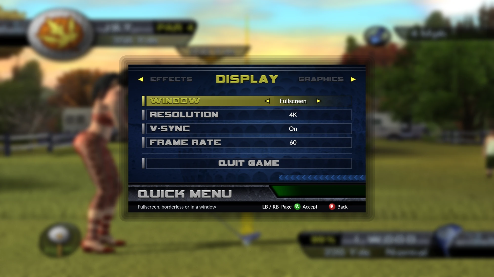
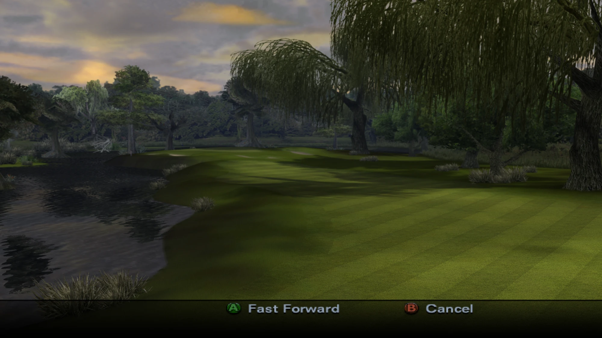
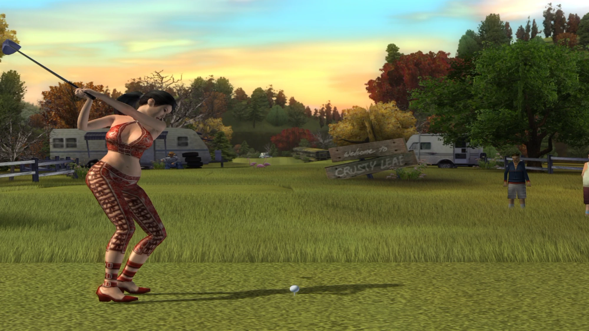

# Outlaw Golf 2 - XBE Recomp

An unofficial native PC port of the original Xbox version of Outlaw Golf 2, with native 60 FPS, higher resolutions, extended graphics options and other enhancements.

This port was created using the [Xbox XBE Recomp](https://github.com/TGP482/XboxXBE-Recomp) tool.

> [!NOTE]
> This project does not include any game code or assets. You must provide the files from your own legally acquired copy of the game. The first start builds the game's code on your PC from that copy.

> [!IMPORTANT]
> Only the **US (NTSC) Xbox version** of the game is supported (title ID 54540017). The supported `default.xbe` has the SHA-1 `3089c412cd4a58da3330da4c8c86ee1c82588af7`.

## Installation

- Extract the release, keeping its folders together.
- Put your game files in the `assets` folder. This can be an ISO, or the extracted data files with `default.xbe` beside its folders.
- Run `OutlawGolf2.exe`. The first start compiles the game's code for your PC. This only happens once.
- Settings can be adjusted in the Quick Menu. The first change writes `settings.toml` beside the exe, where they can also be edited.

## Features

### Quick Menu
Press **F1**, or **Back + Start** on a controller, to open it over the game. Changes apply at once and are saved.

- **Display** - Window mode (fullscreen, borderless or windowed), resolution (Classic, Desktop, 1440p, 4K, 5K and 8K), V-Sync and frame rate (60, or the console's 30).
- **Graphics** - Anti-aliasing (FXAA or SMAA), texture filtering up to 16x, and grass distance up to 6x.
- **Effects** - Bloom and depth of field, each with its own strength.

### 60 FPS

The game runs at a native 60 frames per second, with the game's simulation running 60 times a second too, so motion is smooth rather than repeated. Cameras, the course intro's flyover, the golf cart and the beating minigame were adjusted to keep their console speed at 60.

### Graphics

- **Higher resolutions** - From the console's own 480 lines up to 8K, scaled to your screen.
- **Grass distance** - Tall grass reaches up to six times further from the camera. In views that show a lot of ground, such as the golf cart's, the far edge pulls in a little so the grass nearest the camera is never lost.
- **Bloom and depth of field** - Bloom stays clear of the golfer and the shot preview arc, without halos.
- **Shader cache** - Compiled shaders are kept in `shader_cache` beside the exe, so later runs don't stall on them.

### Controls
Supports Xbox, PlayStation and Switch controllers, with hot plugging and rumble. A controller is needed to play. The keyboard can stand in for a controller in the menus, but it is not set up for play.

### Miscellaneous
- **Boot hint** - Each launch briefly shows how to open the Quick Menu.
- **Boot Splash** - Place a `splash.png` (or `.bmp`) beside the exe to display a splash screen at launch.

## System Requirements

### Minimum
- **OS**
  - Windows 10 64-bit
- **GPU** with support for Direct3D 12

Tested on Windows 11, and on a BC250 running SteamOS through PortProton. Steam Deck and other Linux hardware have not been tested.

## Known Issues

- At 60 FPS the golf cart's steering is a little quicker than on the console. Set the frame rate to 30 in the Quick Menu for the console's handling.
- Keyboard and mouse play is not supported yet.

## Building

### 1. Clone the Repository
Clone this repository using [Git](https://git-scm.com/).

### 2. Add the Required Game Files
Place your extracted game data files in the `assets` folder. `default.xbe` must be there, with the game's folders beside it.

### 3. Install Dependencies
Install Visual Studio 2022 with **Desktop development with C++**, **C++ Clang tools for Windows** and **C++ CMake tools for Windows** (`build.bat` offers to add the last two).

### 4. Build the Project
Run `build.bat`. The first build recompiles the game and takes a while. The exe is written to `out\build\release`.

## Credits

- [Xbox XBE Recomp](https://github.com/TGP482/XboxXBE-Recomp), the recompiler and runtime this is built on.
- [XenonRecomp](https://github.com/hedge-dev/XenonRecomp) for the overridable function layout and instruction hooks.
- [Zydis](https://github.com/zyantific/zydis) for decoding x86 instructions, [toml++](https://github.com/marzer/tomlplusplus) for the configs, [Dear ImGui](https://github.com/ocornut/imgui) for the Quick Menu and [SDL](https://github.com/libsdl-org/SDL) for controllers.
- [LLVM](https://llvm.org)'s Clang and LLD, which build the game's code on your PC.
- [SMAA](https://github.com/iryoku/smaa) by Jorge Jimenez and others for the SMAA anti-aliasing option.
- [Lato](https://www.latofonts.com) (SIL Open Font License) for the Quick Menu's text.

Outlaw Golf is a trademark of its owners. This project is unofficial and is not affiliated with or endorsed by them. Controller button names belong to their owners and are used only to show which button to press.

## License

This port is under the [MIT License](LICENSE). The SDK in `sdk/` keeps its own MIT licence (`sdk/LICENSE`). No game code or data is included: you supply your own copy of the game.

Third-party notices are in `THIRD_PARTY.txt` in the release, or `sdk/THIRD_PARTY.txt` in this repository.
